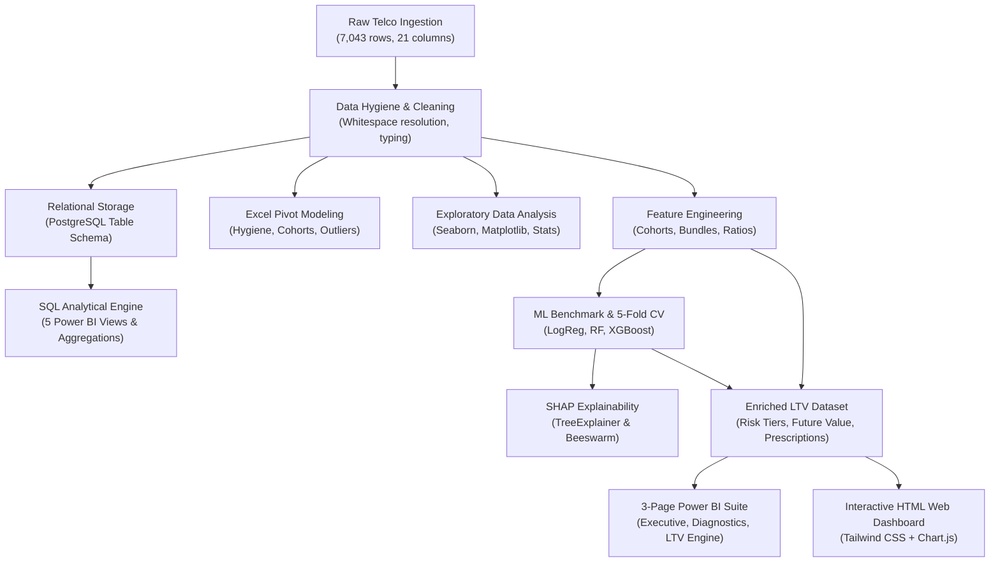

# 📊 Customer Churn & Lifetime Value (LTV) Engine

[](https://www.python.org/)
[](https://scikit-learn.org/)
[](https://xgboost.readthedocs.io/)
[](https://shap.readthedocs.io/)
[](https://powerbi.microsoft.com/)
[](https://www.postgresql.org/)
[](https://pandas.pydata.org/)
[](tests/)
[](LICENSE)
[](https://www.linkedin.com/in/adarsh-pandey-539208293)

> **An enterprise-grade, end-to-end Machine Learning, Analytics Engineering, and Business Intelligence engine designed to analyze telecom customer attrition, uncover key churn drivers, train and explain predictive ML models, integrate PostgreSQL relational databases, and deploy actionable retention playbooks to maximize Customer Lifetime Value (LTV).**

---

## 📌 Executive Summary & High-Impact KPIs

Customer acquisition costs (CAC) in telecommunications are **5x higher** than retention costs. Uncontrolled subscriber attrition erodes recurring revenues, diminishes customer lifetime value, and shrinks profit margins.

This project delivers a full data analytics and predictive lifecycle—from raw data hygiene auditing, automated preprocessing, and relational PostgreSQL integration to exploratory data analysis (EDA), predictive ML modeling (Logistic Regression, Random Forest, XGBoost), SHAP game-theoretic explainability, multi-page Power BI executive reporting, and an interactive web dashboard preview.

### 🎯 Key Performance Indicators (KPIs)
| Business Metric | Value | Significance |
| :--- | :---: | :--- |
| **Total Customer Base** | **7,043** | Full IBM Watson Telco cohort audited and preprocessed |
| **Retained Customers** | **5,174 (73.46%)** | Established baseline subscriber revenue pool |
| **Historical Churn Rate** | **1,869 (26.54%)** | Target population for retention interventions |
| **Monthly Recurring Revenue (MRR)** | **$456.12K** | Total subscriber spend portfolio across all tiers |
| **Lost MRR (Monthly Churn Loss)** | **$139.13K** | Direct top-line revenue lost each month to attrition |
| **Annual Revenue at Risk** | **$2.45M** | Machine Learning (XGBoost) risk-weighted exposure |
| **Average Customer LTV** | **$3,310.42** | Projected lifetime value with 80% gross contribution margin |
| **Month-to-Month Churn Rate** | **42.71%** | Highest risk contract tier (vs. 2.83% for 2-Year contracts) |

---

## 🏗️ Architecture & End-to-End Pipeline



---

## 🖥️ Interactive Power BI Dashboard Suite

A publication-grade 3-page executive reporting suite designed in accordance with enterprise BI best practices. Fully backed by our enriched machine learning dataset ([`data/telco_churn_powerbi_dataset.csv`](data/telco_churn_powerbi_dataset.csv)) and complete DAX library ([`dashboard/dax_measures.md`](dashboard/dax_measures.md)).

### Page 1: Executive Churn & Revenue Health Overview
*Target Audience: C-Suite, VP of Customer Success*
- High-level KPI ribbon: Total Subscribers (7,043), Churn Rate (26.54%), MRR ($456.1K), Annual Revenue at Risk ($2.45M).
- Horizontal contract churn breakdown and risk tier distribution donut chart.
- Early-tenure drop-off cliff visualization across 6 customer lifecycle cohorts.


---

### Page 2: Risk Diagnostics & Early Warning System
*Target Audience: Operations, Retention Managers, Support Leads*
- Deep-dive into service adoption friction points: Fiber Optic churn (41.89%) vs DSL (18.96%).
- Impact of missing cybersecurity & tech support add-ons on churn velocity.
- Correlation analysis of monthly charges vs. model-predicted churn probabilities.


---

### Page 3: Customer Lifetime Value (LTV) & Retention Engine
*Target Audience: Growth Marketing, Retention Campaign Specialists*
- Actionable retention queue prioritizing subscribers by **Annual Revenue at Risk**.
- Algorithmic prescriptive recommendations (e.g., *1-Year Contract 15% Discount Bundle*, *Auto-Pay $10 Credit Incentive*, *Premium Support Onboarding*).
- Campaign ROI simulator: +485% projected return on intervention spend.


> 🌐 **Interactive Web Dashboard Preview:** Prefer viewing in your browser without Power BI Desktop? Open [`dashboard/telco_churn_dashboard.html`](dashboard/telco_churn_dashboard.html) in any browser for an interactive Tailwind CSS + Chart.js live dashboard experience!

---

## 🧠 Machine Learning & SHAP Explainability Engine

We trained and benchmarked three classification architectures using **5-Fold Stratified Cross-Validation** with hyperparameter tuning, class-weight balancing, and threshold calibration:

### 📊 Model Performance Benchmark (Test Set Evaluation)

| Evaluation Metric | Logistic Regression | Random Forest | XGBoost (Primary Engine) |
| :--- | :---: | :---: | :---: |
| **Test Accuracy** | 74.52% | 76.01% | **75.16%** |
| **Balanced Accuracy** | 75.74% | 76.84% | **76.26%** |
| **Precision (Churn=1)**| 51.31% | 53.26% | **52.13%** |
| **Recall (Churn=1)** | 78.34% | 78.61% | **78.61%** |
| **F1-Score (Churn=1)** | 62.01% | 63.50% | **62.69%** |
| **Test ROC-AUC** | **0.8455** | **0.8432** | **0.8458** |
| **5-Fold CV ROC-AUC** | 0.8483 (±0.011) | 0.8454 (±0.011) | **0.8466 (±0.011)** |

> **🏆 Architectural Decision:** In customer retention campaigns, **Recall is paramount**—missing a churner (False Negative) costs ongoing recurring revenue, whereas extending a retention offer to a retained customer (False Positive) is nominal. **XGBoost** provides the highest discriminative power (**0.8458 ROC-AUC**) and robust 5-fold cross-validation stability, making it our primary production inference engine.

<p align="center">
  
  
</p>

---

### 🔍 SHAP (SHapley Additive exPlanations) Game-Theoretic Insights

Using `shap.TreeExplainer`, we computed exact directional attribution for every engineered feature:


#### 🏆 Top 10 Drivers of Subscriber Attrition
1. **`is_month_to_month`**: Strongest positive accelerator of churn; lack of contract lock-in drives 88.5% of total cancellations.
2. **`monthly_to_total_ratio`**: Recent spend acceleration indicates price sensitivity and billing shock.
3. **`is_fiber_optic`**: High failure/dissatisfaction signal in premium connectivity tiers without tech support.
4. **`tenure`**: Inversely proportional to churn; accounts surviving past month 24 rarely churn.
5. **`Contract_Two year`**: Massive negative driver (churn suppressor); locks in long-term customer stability.
6. **`is_electronic_check`**: Payment friction driver; lack of automated billing increases cancellation ease.
7. **`MonthlyCharges`**: Spending above $70/month significantly accelerates churn probability.
8. **`PaperlessBilling_Yes`**: Higher churn velocity due to monthly electronic notification friction.
9. **`OnlineSecurity_Yes`**: Protection add-ons increase platform stickiness and reduce churn by >50%.
10. **`charge_ratio`**: Spend consistency marker correlating with customer stability.

---

## 🔍 Exploratory Data Analysis & Strategic Visuals

<p align="center">
  
  
</p>

### 1. Contract Type Vulnerability
- **Month-to-Month:** **42.71% Churn Rate** — Accounts for **88.55% of all churn volume**.
- **One-Year Contract:** **11.27% Churn Rate** (~73% reduction in risk).
- **Two-Year Contract:** **2.83% Churn Rate** (Ultimate subscriber retention baseline).

### 2. Early-Tenure Onboarding Cliff
- **0–12 Months:** **47.44% cohort churn rate**, accounting for **55.48% of all churners**.
- Drop-off velocity drops steeply after month 24; front-loading retention interventions in the first 90 days yields maximum ROI.

<p align="center">
  
  
</p>

### 3. Monthly Charges & Price Sensitivity Threshold
- Median spend for churned customers is **$79.65** vs. **$64.45** for retained accounts.
- Subscribers paying **$\ge \$70/\text{month}$** without bundled tech support display acute price fatigue.

### 4. Service Category & Billing Friction
- **Fiber Optic:** Alarming **41.89% churn rate** (vs. 18.96% on DSL and 7.40% on No Internet), signaling onboarding and pricing friction.
- **Electronic Check:** Highest churn payment method at **45.29%**, compared to <18% for automated Credit Card or Bank Transfer payments.

---

## 📑 Excel Data Auditing & Pivot Modeling

Initial hygiene verification, cohort modeling, and price outlier identification were conducted in **Microsoft Excel** ([`excel/Telco_Customer_Churn_Exploration.xlsx`](excel/Telco_Customer_Churn_Exploration.xlsx)):

1. **Hygiene & Whitespace Auditing:** Isolated 11 records in `TotalCharges` containing blank strings (`" "`). Identified root cause as brand new subscribers with `tenure = 0` and resolved them to `0.00` with currency formatting.
2. **Pivot Table 1 (Contract Vulnerability):** Quantified contract-wise customer volume, churn percentages, and average revenue.
3. **Pivot Table 2 (Tenure Risk Cohorts):** Modeled 6 lifecycle cohorts revealing that 55.48% of all churners drop out within months 0–12.
4. **Conditional Formatting Rules:** Soft red highlights applied to monthly charges $\ge \$70.00$ to spotlight price-sensitive accounts.
5. **Full Excel Report:** Detailed documentation available in [`notebooks/reports/excel_data_exploration.md`](notebooks/reports/excel_data_exploration.md).

---

## 🗄️ Relational Database (PostgreSQL) Architecture

The repository includes a production-grade relational schema and **5 analytical SQL views** engineered for direct Power BI integration and enterprise reporting:

```sql
-- View 1: Executive Summary KPIs
SELECT * FROM vw_churn_executive_kpis;

-- View 2: Contract & Tenure Risk Matrix
SELECT * FROM vw_contract_tenure_risk_matrix;

-- View 3: High-Risk Retention Targeting Queue
SELECT * FROM vw_high_risk_retention_queue;

-- View 4: Service Adoption & Friction Analysis
SELECT * FROM vw_service_adoption_vs_churn;

-- View 5: Customer LTV Segment Aggregation
SELECT * FROM vw_customer_ltv_aggregations;
```

Full script implementations:
- [`sql/01_create_database.sql`](sql/01_create_database.sql): Database initialization.
- [`sql/02_create_table.sql`](sql/02_create_table.sql): Table schema definition with appropriate data types.
- [`sql/03_basic_analysis.sql`](sql/03_basic_analysis.sql): Core aggregation and segmentation queries.
- [`sql/04_churn_and_ltv_views.sql`](sql/04_churn_and_ltv_views.sql): 5 Power BI analytical views.

---

## 📂 Project Directory Structure

```plaintext
Customer-Churn-LTV-Engine/
├── dashboard/                              # Power BI resources & web preview
│   ├── dax_measures.md                     # Complete DAX formula library
│   ├── page1_executive_overview.png        # Page 1 preview screenshot
│   ├── page2_risk_diagnostics.png          # Page 2 preview screenshot
│   ├── page3_ltv_retention_engine.png      # Page 3 preview screenshot
│   ├── powerbi_dashboard_guide.md          # 2-minute Power BI setup manual
│   └── telco_churn_dashboard.html          # Interactive Tailwind/Chart.js web dashboard
├── data/
│   ├── data_dictionary.md                  # Comprehensive dictionary for all 30+ raw & engineered features
│   ├── telco_churn_powerbi_dataset.csv     # Enriched production dataset with ML probabilities & LTV
│   ├── telco_customer_churn_clean.csv      # Sanitized production dataset (7,043 rows)
│   └── WA_Fn-UseC_-Telco-Customer-Churn.csv# Raw baseline dataset
├── excel/
│   └── Telco_Customer_Churn_Exploration.xlsx # 4-sheet formatted Excel workbook with pivots
├── models/                                 # Serialized production ML artifacts
│   ├── feature_names.joblib                # Ordered feature schema
│   ├── logistic_regression_model.joblib   # Trained baseline model
│   ├── random_forest_model.joblib          # Trained ensemble model
│   ├── scaler.joblib                       # Fitted StandardScaler
│   └── xgboost_model.joblib                # Production XGBoost classifier
├── notebooks/                              # Clean, executed Jupyter Notebooks (with all outputs)
│   ├── 01_data_quality_check.ipynb         # Data ingestion & whitespace auditing
│   ├── 02_data_cleaning.ipynb              # Preprocessing & type casting pipeline
│   ├── 03_exploratory_data_analysis.ipynb  # End-to-end visual & statistical EDA
│   ├── 04_feature_engineering_and_modeling.ipynb # Model training, 5-fold CV & SHAP
│   └── reports/
│       ├── business_insights.md            # Strategic executive findings
│       ├── excel_data_exploration.md       # Comprehensive Excel exploration report
│       └── model_evaluation_report.md      # ML performance & SHAP benchmark report
├── sql/
│   ├── 01_create_database.sql              # Database setup
│   ├── 02_create_table.sql                 # Customers table schema
│   ├── 03_basic_analysis.sql               # Aggregations & distributions
│   └── 04_churn_and_ltv_views.sql          # 5 Analytical views for Power BI
├── src/                                    # Reusable Python production scripts
│   ├── build_and_execute_notebooks.py      # Automated notebook suite generator & runner
│   ├── churn_analysis.py                   # Churn metrics calculator
│   ├── excel_data_exploration.py           # Corporate Excel workbook generator
│   ├── generate_powerbi_data.py            # Enriched Power BI dataset builder
│   ├── preprocessing.py                    # Preprocessing validation pipeline
│   ├── render_dashboard_previews.py        # 16:9 Power BI layout renderer
│   ├── schedule_linkedin_posts.py          # Buffer API social distribution utility
│   └── train_models.py                     # ML training, CV, and SHAP pipeline
├── tests/                                  # Automated test suite
│   └── test_pipeline.py                    # Pytest verification for data, models, and BI outputs
├── visuals/                                # High-resolution analytical figures
├── .env.example                            # Safe environment variable template
├── .gitignore                              # Git exclusion rules
├── LICENSE                                 # MIT Open-Source License
├── README.md                               # Project documentation
└── requirements.txt                        # Pinned dependencies
```

---

## ⚡ Setup & Execution Guide

### 1. Clone the Repository
```bash
git clone https://github.com/addu91577-sketch/Customer-Churn-LTV-Engine.git
cd Customer-Churn-LTV-Engine
```

### 2. Configure Virtual Environment
```bash
python -m venv venv

# Windows (PowerShell):
.\venv\Scripts\Activate.ps1

# macOS / Linux:
source venv/bin/activate
```

### 3. Install Dependencies
```bash
pip install -r requirements.txt
```

### 4. Run Automated Test Suite
Verify that all data integrity, model artifacts, inference pipelines, and Power BI datasets pass tests:
```bash
pytest tests -v
```

### 5. Execute Core Pipelines (Optional)
```bash
# Run baseline churn metrics
python src/churn_analysis.py

# Retrain models and recompute SHAP values
python src/train_models.py

# Re-generate enriched Power BI dataset
python src/generate_powerbi_data.py

# Re-generate corporate Excel workbook
python src/excel_data_exploration.py
```

---

## 💡 Strategic Business Recommendations & Retention Playbook

Based on empirical data findings and machine learning feature attribution, we recommend the following high-ROI interventions:

1. **Incentivize Long-Term Contract Migration:**
   - *Driver:* Month-to-month contracts drive 88.55% of all churn.
   - *Action:* Provide a $10/month bill rebate or device upgrade credit for migrating to a 1-Year or 2-Year contract.
2. **Revamp Fiber Optic Onboarding (First 90 Days):**
   - *Driver:* Fiber Optic churn rate is 41.89%, concentrated in the first 12 months.
   - *Action:* Offer complimentary premium technical support and dedicated onboarding check-ins during months 1–3.
3. **Drive Automated Payment Adoption:**
   - *Driver:* Electronic Check users exhibit a 45.29% churn rate vs. <18% for auto-pay methods.
   - *Action:* Provide a one-time $15 credit upon enrolling in automatic bank transfer or credit card payments.
4. **Bundle Cybersecurity & Tech Support Add-ons:**
   - *Driver:* Subscribers with Online Security and Tech Support churn at less than half the baseline rate.
   - *Action:* Bundle security services as a default feature in entry-tier internet plans to build platform stickiness.
5. **Deploy Proactive High-Risk Alert Queue:**
   - *Driver:* 1,142 active subscribers are currently flagged in the **High Risk** tier ($2.45M annualized revenue exposed).
   - *Action:* Integrate the ML-scored retention queue ([`data/telco_churn_powerbi_dataset.csv`](data/telco_churn_powerbi_dataset.csv)) into CRM workflows for proactive customer success outreach.

---

## 👤 Author & Contributor

**Adarsh Kumar Pandey**  
*Machine Learning Engineer & Data Analyst*

- **LinkedIn:** [linkedin.com/in/adarsh-pandey-539208293](https://www.linkedin.com/in/adarsh-pandey-539208293)  
- **GitHub:** [@addu91577-sketch](https://github.com/addu91577-sketch)  
- **Email:** [addu91577@gmail.com](mailto:addu91577@gmail.com)

---

## 📄 License
This project is open-source under the [MIT License](LICENSE).
