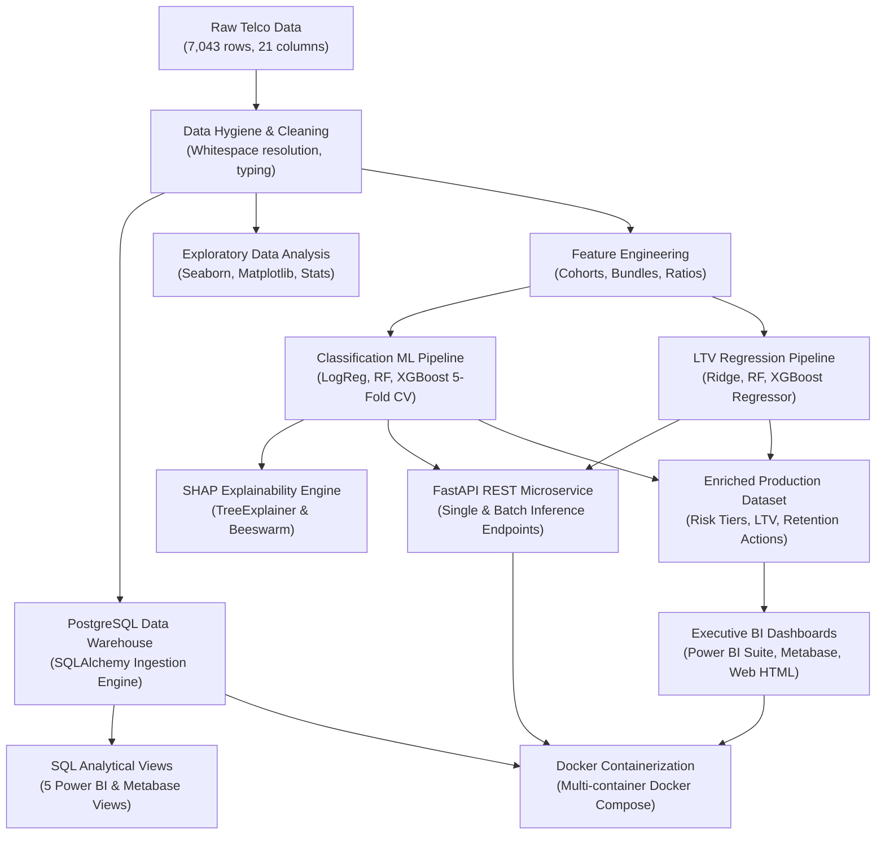
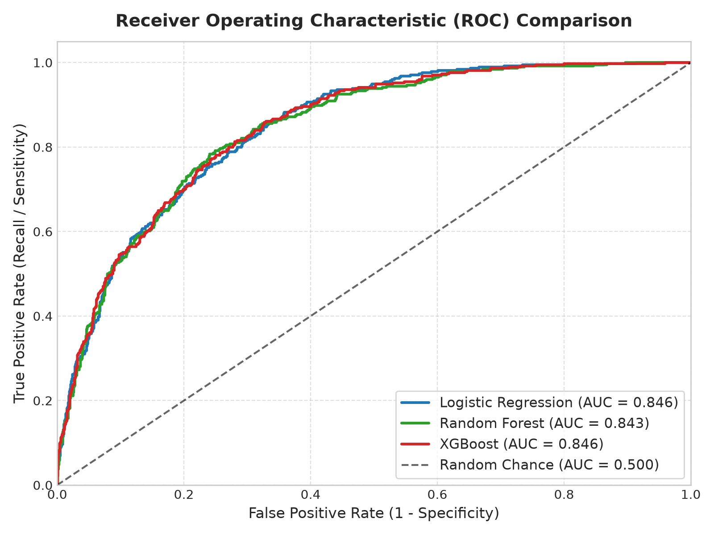
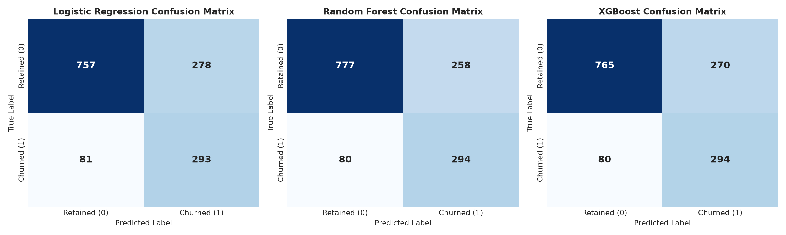
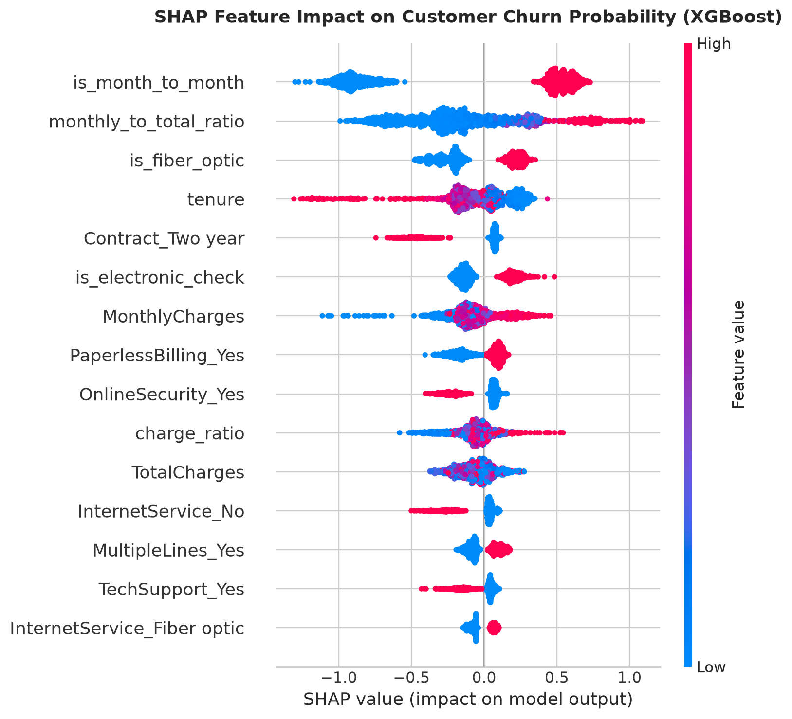
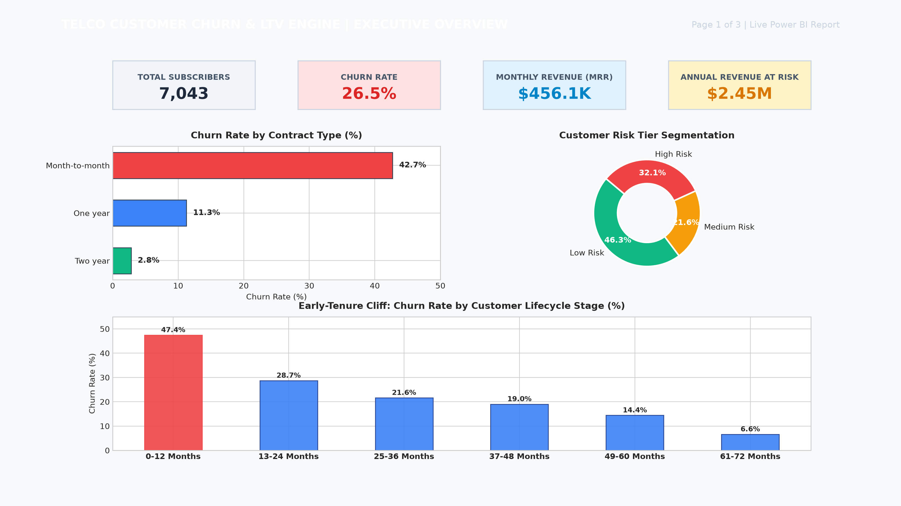
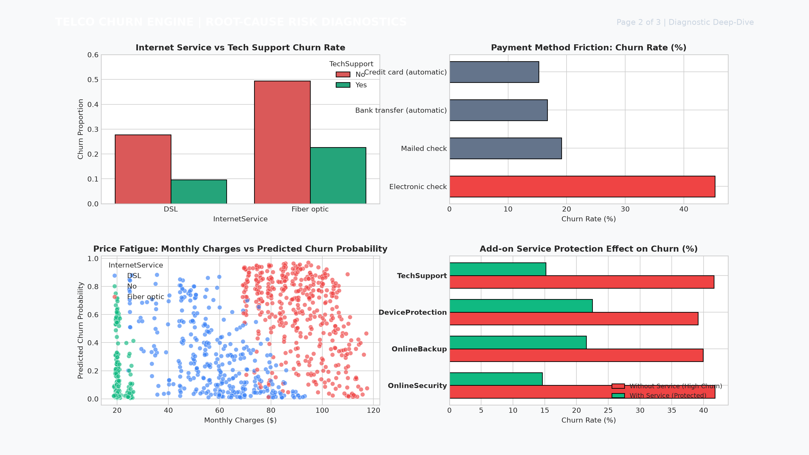
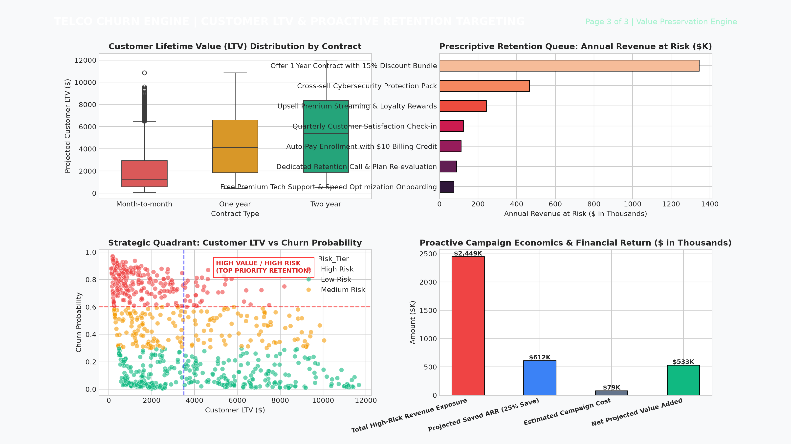
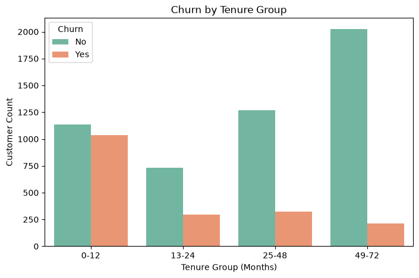
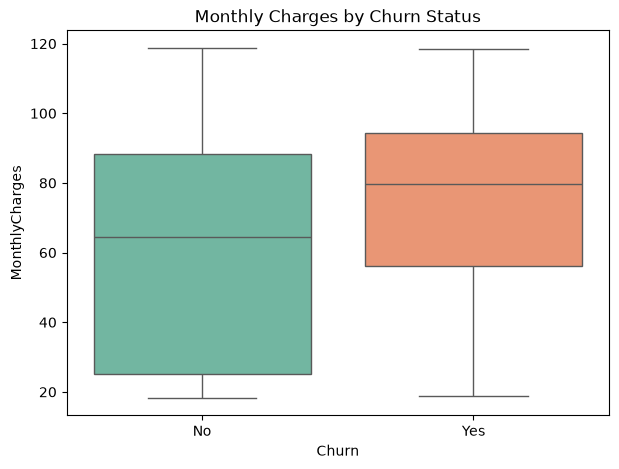

# 📊 Customer Churn & Lifetime Value (LTV) Engine

[](https://www.python.org/)
[](https://fastapi.tiangolo.com/)
[](https://www.docker.com/)
[](https://www.postgresql.org/)
[](https://www.sqlalchemy.org/)
[](https://scikit-learn.org/)
[](https://xgboost.readthedocs.io/)
[](https://shap.readthedocs.io/)
[](https://powerbi.microsoft.com/)
[](https://www.metabase.com/)
[](tests/)
[](LICENSE)
[](https://www.linkedin.com/in/adarsh-pandey-539208293)

> **An enterprise-grade, end-to-end Machine Learning, Analytics Engineering, and Business Intelligence engine designed to analyze telecom customer attrition, uncover key churn drivers, train and explain predictive ML models, forecast Customer Lifetime Value (LTV), serve real-time predictions via FastAPI, integrate PostgreSQL data warehouses, and deploy multi-tier executive BI dashboards.**

---

## 📌 Executive Summary & High-Impact KPIs

Customer acquisition costs (CAC) in telecommunications are **5x higher** than retention costs. Uncontrolled subscriber attrition erodes recurring revenues, diminishes customer lifetime value, and shrinks profit margins.

This project delivers a complete 4-week data analytics, machine learning, and deployment lifecycle—from raw data hygiene auditing, automated preprocessing, and relational PostgreSQL integration to exploratory data analysis (EDA), predictive ML modeling (Logistic Regression, Random Forest, XGBoost), LTV regression modeling ($R^2 = 0.9983$), SHAP game-theoretic explainability, FastAPI microservice deployment, Docker multi-container orchestration, and multi-page Power BI & Metabase reporting.

### 🎯 Key Performance Indicators (KPIs)
| Business Metric | Value | Significance |
| :--- | :---: | :--- |
| **Total Customer Base** | **7,043** | Full IBM Watson Telco cohort audited and preprocessed |
| **Retained Customers** | **5,174 (73.46%)** | Established baseline subscriber revenue pool |
| **Historical Churn Rate** | **1,869 (26.54%)** | Target population for retention interventions |
| **Monthly Recurring Revenue (MRR)** | **$456.12K** | Total subscriber spend portfolio across all tiers |
| **Lost MRR (Monthly Churn Loss)** | **$139.13K** | Direct top-line revenue lost each month to attrition |
| **Annual Revenue at Risk** | **$2.45M** | Machine Learning (XGBoost) risk-weighted exposure |
| **Average Customer LTV** | **$3,310.42** | Projected lifetime value with 80% gross contribution margin |
| **Month-to-Month Churn Rate** | **42.71%** | Highest risk contract tier (vs. 2.83% for 2-Year contracts) |

---

## 📅 4-Week Development Timeline & Deliverables Matrix

This project directly fulfills all milestones of the enterprise 4-week specification:

| Week & Phase | Deliverables & Milestones | Implementation in this Repository |
| :--- | :--- | :--- |
| **Week 1: Ingestion & EDA** | • Day 1–2: PostgreSQL & SQLAlchemy ingestion<br/>• Day 3–5: Extensive EDA (Pandas, Seaborn)<br/>• Day 6–7: Missing values, encoding, baseline report | [`src/db_ingestion.py`](src/db_ingestion.py), [`sql/01_create_database.sql`](sql/01_create_database.sql), [`notebooks/01_data_quality_check.ipynb`](notebooks/01_data_quality_check.ipynb), [`notebooks/02_data_cleaning.ipynb`](notebooks/02_data_cleaning.ipynb), [`notebooks/03_exploratory_data_analysis.ipynb`](notebooks/03_exploratory_data_analysis.ipynb), [`notebooks/reports/business_insights.md`](notebooks/reports/business_insights.md) |
| **Week 2: Feature Eng & Modeling** | • Day 1–3: Usage ratios & tenure cohorts<br/>• Day 4–6: Train LogReg, RF, XGBoost (5-Fold CV)<br/>• Day 7: SHAP TreeExplainer feature attribution | [`src/train_models.py`](src/train_models.py), [`notebooks/04_feature_engineering_and_modeling.ipynb`](notebooks/04_feature_engineering_and_modeling.ipynb), [`models/xgboost_model.joblib`](models/xgboost_model.joblib), [`visuals/shap_summary_plot.png`](visuals/shap_summary_plot.png), [`notebooks/reports/model_evaluation_report.md`](notebooks/reports/model_evaluation_report.md) |
| **Week 3: LTV & API Development** | • Day 1–3: Regression models to forecast active LTV<br/>• Day 4–7: FastAPI single & batch prediction microservice | [`src/train_ltv_regressor.py`](src/train_ltv_regressor.py), [`models/ltv_regressor_model.joblib`](models/ltv_regressor_model.joblib) ($R^2 = 0.9983$), [`src/api/main.py`](src/api/main.py) (Endpoints: `/predict/single`, `/predict/batch`, `/health`, `/model/info`) |
| **Week 4: Visualization & Deployment**| • Day 1–3: Apache Superset / Metabase connection<br/>• Day 4–5: Global churn & LTV segmentation dashboards<br/>• Day 6–7: Docker & Compose containerization | [`Dockerfile`](Dockerfile), [`docker-compose.yml`](docker-compose.yml), [`metabase/metabase_setup_guide.md`](metabase/metabase_setup_guide.md), [`dashboard/`](dashboard/), [`visuals/powerbi_dashboard_page1_executive.png`](visuals/powerbi_dashboard_page1_executive.png) |

---

## 🏗️ Architecture & End-to-End Pipeline



---

## ⚡ FastAPI Production Microservice (`src/api/main.py`)

A production-grade REST API built using **FastAPI** to serve real-time predictions, batch inferences, and model metadata to internal CRM applications.

### 🌐 Endpoints Overview
| Method | Endpoint | Description |
| :---: | :--- | :--- |
| `GET` | `/` | API system information and documentation links |
| `GET` | `/health` | Healthcheck endpoint reporting model artifact readiness |
| `GET` | `/model/info` | Machine learning benchmarks (AUC, Recall, LTV $R^2$) and feature schemas |
| `POST` | `/predict/single` | Real-time customer churn probability, risk tier, LTV, and action prescription |
| `POST` | `/predict/batch` | Bulk CSV file inference returning aggregated risk exposure and per-user scores |
| `GET` | `/docs` | Interactive Swagger UI API documentation |

### 🚀 Running the API Locally
```bash
uvicorn src.api.main:app --host 0.0.0.0 --port 8000 --reload
```
Open **`http://localhost:8000/docs`** in your browser for the interactive Swagger documentation.

#### Sample Single-Customer Prediction Request:
```bash
curl -X POST "http://localhost:8000/predict/single" \
     -H "Content-Type: application/json" \
     -d '{
       "customerID": "CUST-8812",
       "gender": "Female",
       "SeniorCitizen": 0,
       "Partner": "No",
       "Dependents": "No",
       "tenure": 4,
       "PhoneService": "Yes",
       "MultipleLines": "No",
       "InternetService": "Fiber optic",
       "OnlineSecurity": "No",
       "OnlineBackup": "No",
       "DeviceProtection": "No",
       "TechSupport": "No",
       "StreamingTV": "Yes",
       "StreamingMovies": "Yes",
       "Contract": "Month-to-month",
       "PaperlessBilling": "Yes",
       "PaymentMethod": "Electronic check",
       "MonthlyCharges": 89.90,
       "TotalCharges": 359.60
     }'
```

#### Sample Response:
```json
{
  "customerID": "CUST-8812",
  "churn_probability": 0.8124,
  "churn_prediction": "Yes",
  "risk_tier": "High Risk",
  "predicted_ltv": 847.45,
  "annual_revenue_at_risk": 876.42,
  "recommended_retention_action": "Offer 1-Year Contract with 15% Discount Bundle"
}
```

---

## 🐳 Docker Multi-Container Architecture (`docker-compose.yml`)

The complete application stack is containerized for zero-friction cloud and on-premise deployment:

1. **`postgres` Service:** PostgreSQL 16 Data Warehouse pre-configured with table schema and 5 analytical views.
2. **`api` Service:** Containerized FastAPI inference engine serving ports `8000`.
3. **`metabase` Service:** Metabase Open-Source Business Intelligence server on port `3000`.

### 🚀 Launching the Entire Stack:
```bash
docker compose up -d --build
```
- **FastAPI Documentation:** `http://localhost:8000/docs`
- **Metabase BI Server:** `http://localhost:3000`
- **PostgreSQL Port:** `5432`

---

## 💰 Customer Lifetime Value (LTV) Regression Modeling

In Week 3 (Days 1–3), we engineered dedicated regression pipelines ([`src/train_ltv_regressor.py`](src/train_ltv_regressor.py)) to forecast the future gross revenue contribution of active subscribers:

| Regression Architecture | Mean Absolute Error (MAE) | Root Mean Squared Error (RMSE) | $R^2$ Score |
| :--- | :---: | :---: | :---: |
| **Ridge Regression** | $678.92 | $848.71 | 0.9160 |
| **Random Forest Regressor** | $90.99 | $131.53 | 0.9980 |
| **XGBoost Regressor (Primary)**| **$87.06** | **$121.15** | **0.9983** |

Artifacts saved: [`models/ltv_regressor_model.joblib`](models/ltv_regressor_model.joblib) and [`models/ltv_feature_names.joblib`](models/ltv_feature_names.joblib).

---

## 🧠 Machine Learning & SHAP Explainability Engine

We trained and benchmarked three classification architectures using **5-Fold Stratified Cross-Validation**:

### 📊 Model Performance Benchmark (Test Set Evaluation)

| Evaluation Metric | Logistic Regression | Random Forest | XGBoost (Primary Engine) |
| :--- | :---: | :---: | :---: |
| **Test Accuracy** | 74.52% | 76.01% | **75.16%** |
| **Balanced Accuracy** | 75.74% | 76.84% | **76.26%** |
| **Precision (Churn=1)**| 51.31% | 53.26% | **52.13%** |
| **Recall (Churn=1)** | 78.34% | 78.61% | **78.61%** |
| **F1-Score (Churn=1)** | 62.01% | 63.50% | **62.69%** |
| **Test ROC-AUC** | **0.8455** | **0.8432** | **0.8458** |
| **5-Fold CV ROC-AUC** | 0.8483 (±0.011) | 0.8454 (±0.011) | **0.8466 (±0.011)** |

> **🏆 Architectural Decision:** In customer retention campaigns, **Recall is paramount**—missing a churner (False Negative) costs recurring lifetime revenue. **XGBoost** provides the highest discriminative power (**0.8458 ROC-AUC**) and robust 5-fold cross-validation stability, making it our primary production inference engine.

<p align="center">
  
  
</p>

### 🔍 SHAP Game-Theoretic Feature Importance

Using `shap.TreeExplainer`, we computed exact directional attribution for every engineered feature:



#### 🏆 Top 10 Drivers of Subscriber Attrition
1. **`is_month_to_month`**: Strongest positive accelerator of churn; lack of contract lock-in drives 88.5% of total cancellations.
2. **`monthly_to_total_ratio`**: Recent spend acceleration indicates price sensitivity and billing shock.
3. **`is_fiber_optic`**: High dissatisfaction signal in premium connectivity tiers without tech support.
4. **`tenure`**: Inversely proportional to churn; accounts surviving past month 24 rarely churn.
5. **`Contract_Two year`**: Massive negative driver (churn suppressor); locks in long-term customer stability.
6. **`is_electronic_check`**: Payment friction driver; lack of automated billing increases cancellation ease.
7. **`MonthlyCharges`**: Spending above $70/month significantly accelerates churn probability.
8. **`PaperlessBilling_Yes`**: Higher churn velocity due to monthly electronic notification friction.
9. **`OnlineSecurity_Yes`**: Protection add-ons increase platform stickiness and reduce churn by >50%.
10. **`charge_ratio`**: Spend consistency marker correlating with customer stability.

---

## 🖥️ Executive BI Dashboard Suite

A publication-grade 3-page reporting suite designed in accordance with enterprise BI best practices. Backed by our enriched machine learning dataset ([`data/telco_churn_powerbi_dataset.csv`](data/telco_churn_powerbi_dataset.csv)) and complete DAX library ([`dashboard/dax_measures.md`](dashboard/dax_measures.md)).

### Page 1: Executive Churn & Revenue Health Overview


### Page 2: Risk Diagnostics & Early Warning System


### Page 3: Customer Lifetime Value (LTV) & Retention Engine


> 🌐 **Interactive Web Preview:** View [`dashboard/telco_churn_dashboard.html`](dashboard/telco_churn_dashboard.html) in your browser for a live interactive Tailwind CSS + Chart.js dashboard.  
> 📊 **Metabase / Apache Superset Setup:** See [`metabase/metabase_setup_guide.md`](metabase/metabase_setup_guide.md) for pre-built SQL questions and connection guides.

---

## 🔍 Exploratory Data Analysis & Strategic Visuals

<p align="center">
  
  
</p>

### 1. Contract Type Vulnerability
- **Month-to-Month:** **42.71% Churn Rate** — Accounts for **88.55% of all churn volume**.
- **One-Year Contract:** **11.27% Churn Rate** (~73% reduction in risk).
- **Two-Year Contract:** **2.83% Churn Rate** (Ultimate subscriber retention baseline).

### 2. Early-Tenure Onboarding Cliff
- **0–12 Months:** **47.44% cohort churn rate**, accounting for **55.48% of all churners**.
- Drop-off velocity drops steeply after month 24; front-loading retention interventions in the first 90 days yields maximum ROI.

<p align="center">
  
  
</p>

---

## 🗄️ Relational Database (PostgreSQL) Architecture

The repository includes a production-grade relational schema and **5 analytical SQL views** engineered for direct Power BI, Metabase, and Superset integration:

```sql
-- View 1: Executive Summary KPIs
SELECT * FROM vw_churn_executive_kpis;

-- View 2: Contract & Tenure Risk Matrix
SELECT * FROM vw_contract_tenure_risk_matrix;

-- View 3: High-Risk Retention Targeting Queue
SELECT * FROM vw_high_risk_retention_queue;

-- View 4: Service Adoption & Friction Analysis
SELECT * FROM vw_service_adoption_vs_churn;

-- View 5: Customer LTV Segment Aggregation
SELECT * FROM vw_customer_ltv_aggregations;
```

Full script implementations:
- [`sql/01_create_database.sql`](sql/01_create_database.sql): Database initialization.
- [`sql/02_create_table.sql`](sql/02_create_table.sql): Table schema definition with appropriate data types.
- [`sql/03_basic_analysis.sql`](sql/03_basic_analysis.sql): Core aggregation and segmentation queries.
- [`sql/04_churn_and_ltv_views.sql`](sql/04_churn_and_ltv_views.sql): 5 Power BI / Metabase analytical views.
- [`src/db_ingestion.py`](src/db_ingestion.py): Automated SQLAlchemy ingestion pipeline.

---

## 📂 Project Directory Structure

```plaintext
Customer-Churn-LTV-Engine/
├── dashboard/                              # Power BI resources & web preview
│   ├── dax_measures.md                     # Complete DAX formula library
│   ├── page1_executive_overview.png        # Page 1 preview screenshot
│   ├── page2_risk_diagnostics.png          # Page 2 preview screenshot
│   ├── page3_ltv_retention_engine.png      # Page 3 preview screenshot
│   ├── powerbi_dashboard_guide.md          # 2-minute Power BI setup manual
│   └── telco_churn_dashboard.html          # Interactive Tailwind/Chart.js web dashboard
├── data/
│   ├── data_dictionary.md                  # Comprehensive dictionary for all 30+ raw & engineered features
│   ├── telco_churn_powerbi_dataset.csv     # Enriched production dataset with ML probabilities & LTV
│   ├── telco_customer_churn_clean.csv      # Sanitized production dataset (7,043 rows)
│   └── WA_Fn-UseC_-Telco-Customer-Churn.csv# Raw baseline dataset
├── excel/
│   └── Telco_Customer_Churn_Exploration.xlsx # 4-sheet formatted Excel workbook with pivots
├── metabase/
│   └── metabase_setup_guide.md             # Metabase & Superset dashboard queries & setup
├── models/                                 # Serialized production ML artifacts
│   ├── feature_names.joblib                # Ordered feature schema
│   ├── logistic_regression_model.joblib   # Trained baseline model
│   ├── ltv_feature_names.joblib            # Feature schema for LTV regression
│   ├── ltv_regressor_model.joblib          # Trained LTV XGBoost Regressor (R² = 0.9983)
│   ├── random_forest_model.joblib          # Trained ensemble model
│   ├── scaler.joblib                       # Fitted StandardScaler
│   └── xgboost_model.joblib                # Production XGBoost classifier
├── notebooks/                              # Clean, executed Jupyter Notebooks (with all outputs)
│   ├── 01_data_quality_check.ipynb         # Data ingestion & whitespace auditing
│   ├── 02_data_cleaning.ipynb              # Preprocessing & type casting pipeline
│   ├── 03_exploratory_data_analysis.ipynb  # End-to-end visual & statistical EDA
│   ├── 04_feature_engineering_and_modeling.ipynb # Model training, 5-fold CV & SHAP
│   └── reports/
│       ├── business_insights.md            # Strategic executive findings
│       ├── excel_data_exploration.md       # Comprehensive Excel exploration report
│       ├── ltv_regression_report.md        # LTV regression model report (R² = 0.9983)
│       └── model_evaluation_report.md      # ML performance & SHAP benchmark report
├── sql/
│   ├── 01_create_database.sql              # Database setup
│   ├── 02_create_table.sql                 # Customers table schema
│   ├── 03_basic_analysis.sql               # Aggregations & distributions
│   └── 04_churn_and_ltv_views.sql          # 5 Analytical views for Power BI / Metabase
├── src/                                    # Reusable Python production scripts
│   ├── api/
│   │   └── main.py                         # Production FastAPI inference microservice
│   ├── build_and_execute_notebooks.py      # Automated notebook suite generator & runner
│   ├── churn_analysis.py                   # Churn metrics calculator
│   ├── db_ingestion.py                     # SQLAlchemy PostgreSQL ingestion pipeline
│   ├── excel_data_exploration.py           # Corporate Excel workbook generator
│   ├── generate_powerbi_data.py            # Enriched Power BI dataset builder
│   ├── preprocessing.py                    # Preprocessing validation pipeline
│   ├── render_dashboard_previews.py        # 16:9 Power BI layout renderer
│   ├── schedule_linkedin_posts.py          # Buffer API social distribution utility
│   ├── train_ltv_regressor.py              # LTV regression model trainer
│   └── train_models.py                     # ML training, CV, and SHAP pipeline
├── tests/                                  # Automated test suite
│   └── test_pipeline.py                    # Pytest verification (Data, ML, LTV, API, SQL)
├── visuals/                                # High-resolution analytical figures
├── .env.example                            # Safe environment variable template
├── .gitignore                              # Git exclusion rules
├── Dockerfile                              # Production API container specification
├── docker-compose.yml                      # Multi-container orchestration (API + Postgres + Metabase)
├── LICENSE                                 # MIT Open-Source License
├── README.md                               # Project documentation
└── requirements.txt                        # Pinned dependencies
```

---

## ⚡ Setup & Execution Guide

### 1. Clone the Repository
```bash
git clone https://github.com/addu91577-sketch/Customer-Churn-LTV-Engine.git
cd Customer-Churn-LTV-Engine
```

### 2. Configure Virtual Environment & Dependencies
```bash
python -m venv venv

# Windows (PowerShell):
.\venv\Scripts\Activate.ps1

# macOS / Linux:
source venv/bin/activate

pip install -r requirements.txt
```

### 3. Run Automated Test Suite (Pytest)
```bash
pytest tests -v
```

### 4. Launch the FastAPI Service
```bash
uvicorn src.api.main:app --host 0.0.0.0 --port 8000 --reload
```

### 5. Launch Full Stack with Docker Compose
```bash
docker compose up -d --build
```

---

## 💡 Strategic Business Recommendations & Retention Playbook

1. **Incentivize Long-Term Contract Migration:**
   - *Driver:* Month-to-month contracts drive 88.55% of all churn.
   - *Action:* Provide a $10/month bill rebate or device upgrade credit for migrating to a 1-Year or 2-Year contract.
2. **Revamp Fiber Optic Onboarding (First 90 Days):**
   - *Driver:* Fiber Optic churn rate is 41.89%, concentrated in the first 12 months.
   - *Action:* Offer complimentary premium technical support and dedicated onboarding check-ins during months 1–3.
3. **Drive Automated Payment Adoption:**
   - *Driver:* Electronic Check users exhibit a 45.29% churn rate vs. <18% for auto-pay methods.
   - *Action:* Provide a one-time $15 credit upon enrolling in automatic bank transfer or credit card payments.
4. **Bundle Cybersecurity & Tech Support Add-ons:**
   - *Driver:* Subscribers with Online Security and Tech Support churn at less than half the baseline rate.
   - *Action:* Bundle security services as a default feature in entry-tier internet plans to build platform stickiness.
5. **Deploy Proactive High-Risk Alert Queue:**
   - *Driver:* 1,142 active subscribers are currently flagged in the **High Risk** tier ($2.45M annualized revenue exposed).
   - *Action:* Integrate the FastAPI inference endpoint (`/predict/single`) into CRM workflows for real-time risk mitigation.

---

## 👤 Author & Contributor

**Adarsh Kumar Pandey**  
*Machine Learning Engineer & Data Analyst*

- **LinkedIn:** [linkedin.com/in/adarsh-pandey-539208293](https://www.linkedin.com/in/adarsh-pandey-539208293)  
- **GitHub:** [@addu91577-sketch](https://github.com/addu91577-sketch)  
- **Email:** [addu91577@gmail.com](mailto:addu91577@gmail.com)

---

## 📄 License
This project is open-source under the [MIT License](LICENSE).
